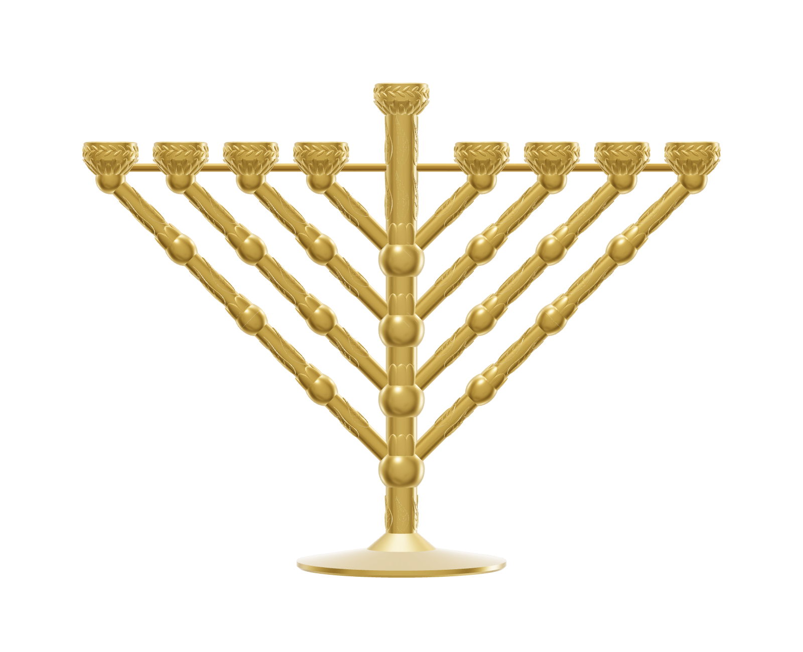

[](https://github.com/PHPCraftdream/chanukia-lemon/actions/workflows/ci.yml)


<p align="center"></p>

# Chanukia Lemon — ханукия для чайных свечей

**Языки:** [English](README.md) · **Русский** · [עברית](README.he.md)

**Сайт с 3D-моделью и файлами для печати:** https://phpcraftdream.github.io/chanukia-lemon/

Параметрическая модель хабадской ханукии для 3D-печати: центральный ствол на ножке,
прямые ветви под 45° с завязями (капторим), листьями и рельефом «языки пламени»,
чаши под чайные свечи с лавровыми венками, шамаш наверху ствола.

Код на TypeScript. Геометрию строит библиотека
[manifold-3d](https://github.com/elalish/manifold) (WebAssembly); на выходе STL
для мастерской, 3D-сайт одним HTML-файлом и проверочные картинки.

## Быстрый старт

Нужен Node.js 24 или новее: он запускает `.ts` напрямую, без сборки.

```sh
npm install
npm run build          # STL + out_chabad/hanukia.html
npm test
```

`out_chabad/hanukia.html` — весь сайт одним файлом: открывается двойным щелчком,
без сервера и интернета (код и модели вшиты в файл, около 6 МБ).

| Команда                | Что делает                                                      |
| ---------------------- | --------------------------------------------------------------- |
| `npm run build`        | `build:stl` + `build:site`                                      |
| `npm run build:stl`    | детали → STL в `out_chabad/` + пакет сцены для сайта            |
| `npm run build:site`   | бандл сайта (rspack) → `out_chabad/hanukia.html` + его проверка |
| `npm run site`         | dev-сервер сайта на http://localhost:5173                       |
| `npm test`             | тесты (`node:test`): расстановка, форматы, детали, посадки, переводы |
| `npm run review`       | проверка сборки: касания, зазоры, пути установки               |
| `npm run render`       | проверочные PNG (крупные планы и разрезы) → `out_chabad/inspect/` |
| `npm run docs`         | пересобрать README на трёх языках из `root-docs/`              |
| `npm run typecheck`    | проверка типов (Node-код и сайт)                                |

## Файлы для мастерской

Все `chabad_*.stl` из `out_chabad/` (их же можно скачать на сайте), кроме
`chabad_full.stl` — это вся ханукия одной моделью, только для просмотра.

| Файл                           | Кол-во | Примечание                                   |
| ------------------------------ | -----: | -------------------------------------------- |
| `chabad_fit_test.stl`          |      1 | **печатать первым**: проверка посадок        |
| `chabad_stem_lower.stl`        |      1 | ножка и низ ствола                           |
| `chabad_stem_upper.stl`        |      1 | верх ствола с шамашем                        |
| `chabad_branch1_x2.stl` … `3`  |      2 | ветви (правая и левая одинаковые)            |
| `chabad_branch4a_inner_x2.stl` |      2 | длинная ветвь, внутренняя половина           |
| `chabad_branch4b_outer_x2.stl` |      2 | длинная ветвь, внешняя половина              |
| `chabad_rod_pin_x1.stl`        |      1 | левая половина стержня жёсткости (со штырём) |
| `chabad_rod_socket_x1.stl`     |      1 | правая половина стержня (с гнездом)          |

## Печать

FDM, PETG. Рекомендуемые настройки:

- стол не меньше 300 мм (самая длинная ветвь — 298 мм; стержни встают на 256 мм по диагонали);
- ствол и ножка: 4 периметра, заполнение гироид 12–15 %;
- ветви: 4–5 периметров, заполнение гироид 25–30 %;
- стержни, шипы и штыри: сплошные;
- слой 0,12–0,16 мм, чтобы рельеф остался чётким;
- ветви печатаются с поддержками, верх ствола — с полями (brim).

Свечи — только в алюминиевых гильзах; горящую ханукию не оставлять без присмотра.

## Сборка изделия

1. Соединить половины ствола (штыри с обжимными рёбрами), стык проклеить.
2. Вставить ветви **от ствола наружу**: 1, 2, 3, затем длинную (сначала собрать её из двух
   половин). Каждая ветвь входит вдоль своей оси: шип в гнездо, трубка в углубление узла.
3. Вставить половины стержня с двух сторон через отверстия в чашах до защёлкивания «джека»
   в стволе.
4. Капнуть клей (эпоксидка или цианоакрилат) в каждое отверстие стержня в чашах с тыльной
   стороны.

Посадки: по телу детали зазор 0,15 мм на сторону, обжимные рёбра дают натяг около 0,1 мм.
Отверстия под стержень в чашах увеличены (зазор 0,75 мм) — они поглощают погрешности печати
и усадку; положение стержня задаёт точное отверстие в стволе. Если тестовый образец входит
слишком туго или болтается — поправьте `SOCKET_R`, `ROD_HOLE_R` и высоты рёбер `*_RIB_H`
в `src/params.ts` и пересоберите.

## Параметры

Все размеры — в [`src/params.ts`](src/params.ts), у каждого есть описание. Главные:

| Параметр                         | Значение | Смысл                                 |
| -------------------------------- | -------: | ------------------------------------- |
| `POCKET_D`                       |    40 мм | диаметр гнезда под свечу              |
| `GAP`                            |    14 мм | зазор между чашами (шаг свечей 60 мм) |
| `STEM_OFFSET`                    |    20 мм | отступ чаш от ствола (жар от шамаша)  |
| `SHAMASH_LIFT`                   |    50 мм | насколько шамаш выше остальных        |
| `STEM_R` / `BRANCH_R` / `FOOT_R` |          | толщина ствола и ветвей, радиус ножки |
| `Z_J0`                           |    84 мм | высота нижней ветви над столом        |

Габарит изделия: 545 × 180 × 414 мм.

## Устройство кода

```
src/
  params.ts       all parameters
  layout.ts       placement of branches, cups and knops (pure math)
  geom.ts         manifold-3d set-up, WASM memory tracking, primitives
  fits.ts         joints: ribs, D-holes, split cuts with pins
  decor.ts        wreath, grooves, calyx, leaves, flame tongues
  parts/          parts: cup, branch, stem, rod, fit-test
  assembly.ts     print-part catalogue and the whole assembly
  stl.ts          STL read/write, volume, watertightness
  scene-pack.ts   scene package format for the site (Node and browser)
  affine.ts       assembled -> print matrix from two copies of a mesh
  credits.ts      author attribution (GPL-3.0 section 7(b))
  build.ts        CLI: STL + scene package
  package.ts      CLI: ZIP for the print shop (STL, instructions, licences, links)
  standalone.ts   CLI: the self-contained hanukia.html (poster and icon embedded)
  site.ts         CLI: GitHub Pages site — /, /ru/, /he/, sitemap, preview image
  seo.ts          per-language pages, hreflang, Open Graph, schema.org, sitemap
  zip.ts crc32.ts minimal deterministic ZIP writer
  tools/          review, render, compare-stl, check-standalone, docs, poster
web/              site: index.html, styles.css, src/ (i18n, themes, viewer, gallery)
test/             node:test suites
root-docs/        README sources in three languages (polydoc)
```

Координаты: Z вверх, ось ствола — Z, ветви в плоскости XZ (+X — правая половина),
фронт смотрит в −Y. Детали строятся для правой половины, левая — зеркальное отражение.

После изменения геометрии: `npm run build`, затем `npm run review` и `npm run render`,
и просмотреть картинки. При рефакторинге без изменения формы
`npm run compare <эталон> out_chabad` должен показать `same` для всех файлов.

## CI и сайт

На каждый пуш и pull request GitHub Actions ([`.github/workflows/ci.yml`](.github/workflows/ci.yml))
проверяет форматирование, типы, тесты и переводы README, затем собирает модели и сайт.
Из ветки `main` результат публикуется на GitHub Pages: главная страница — сайт с 3D-моделью,
рядом лежат все STL для скачивания.

## Лицензия

У проекта две лицензии (подробности в [NOTICE](NOTICE)):

- **исходный код** — [GNU GPL v3](LICENSE) с условием об авторстве по разделу 7(b);
- **модели** (дизайн, все STL, рендеры, напечатанные изделия и любые производные,
  включая модели из форков) — [Chanukia Lemon Model License](LICENSE-MODELS.md).

Модели можно свободно использовать, менять, распространять и печатать. **Продавать изделия,
напечатанные из этих моделей, из форков и любых производных, можно только если к каждой
покупке приложено указание автора с обеими ссылками** (например, карточка в упаковке):

> Chanukia Lemon by PHPCraftdream — https://phpcraftdream.github.io/chanukia-lemon/ —
> https://github.com/PHPCraftdream/chanukia-lemon

Атрибуция уже встроена в заголовок каждого STL и в сайт.
